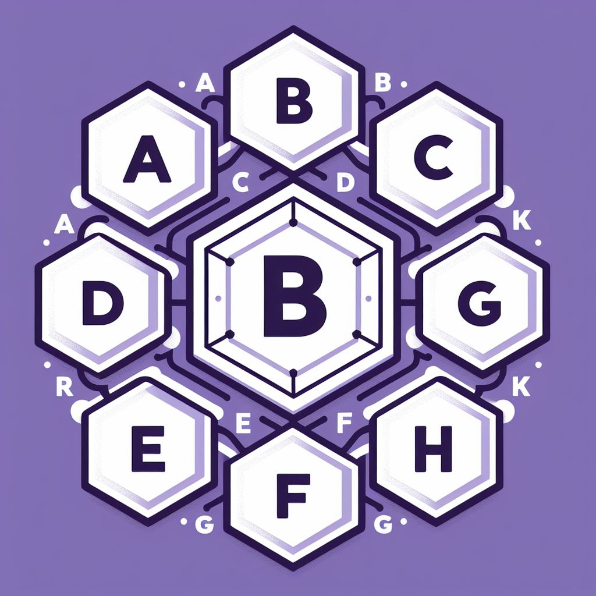

# Gelişmiş Kelime Üretme Oyunu

> Altıgen harf tahtasında anlamlı kelimeler üreten, çevrimdışı ve çevrimiçi oyun modları sunan tam yığın kelime oyunu.

<p>
  
  
  
  
  
</p>

## İçindekiler

- [Proje Hakkında](#proje-hakkında)
- [Öne Çıkan Özellikler](#öne-çıkan-özellikler)
- [Nasıl Oynanır](#nasıl-oynanır)
- [Teknoloji Yığını](#teknoloji-yığını)
- [Mimari Yapı](#mimari-yapı)
- [Kurulum](#kurulum)
- [Çalıştırma](#çalıştırma)
- [Ortam Değişkenleri](#ortam-değişkenleri)
- [API Uç Noktaları](#api-uç-noktaları)
- [Veri Modelleri](#veri-modelleri)
- [Dizin Yapısı](#dizin-yapısı)
- [Komutlar ve Test](#komutlar-ve-test)
- [Güvenlik ve Bilinen Sınırlamalar](#güvenlik-ve-bilinen-sınırlamalar)
- [Katkıda Bulunma](#katkıda-bulunma)
- [Lisans](#lisans)

## Proje Hakkında

Gelişmiş Kelime Üretme Oyunu, kullanıcıya rastgele oluşturulmuş altıgen harf tahtası üzerinde Türkçe kelimeler üretme görevi veren bir web oyunudur.

Oyuncular altıgenlerden harfleri seçebilir, klavyeden kelime yazabilir, süre içinde geçerli kelimeler üretebilir ve puanlarını artırabilir. Oturum açan kullanıcılar oyun sonuçlarını kaydedebilir, kişisel geçmişlerini görüntüleyebilir, profilini yönetebilir ve liderlik sıralamasında yer alabilir.

> Proje React tabanlı istemci, Express tabanlı REST API ve MongoDB veritabanından oluşan iki parçalı bir uygulamadır.

## Öne Çıkan Özellikler

- 7 altıgenli rastgele harf tahtası
- 4 sesli ve 3 sessiz harften oluşan benzersiz harf seti
- `kelimeler.txt` dosyasına dayalı kelime doğrulama
- Merkez harf zorunluluğu
- En az 4 harfli kelime kuralı
- Harf dışı kullanım, tekrarlı kelime ve geçersiz kelime kontrolleri
- Süresi 180 saniye olan geri sayım
- Çevrimdışı ve giriş gerektiren çevrimiçi oyun modları
- Oyun başına puan ve bulunan kelime istatistikleri
- Kullanıcı hesabı oluşturma, giriş, profil güncelleme ve hesap silme
- JWT tabanlı oturum verisi ve `localStorage` oturumu
- Kullanıcıya özel oyun geçmişi
- En yüksek skorları kullanıcı bazında sıralayan liderlik tablosu
- Bulunan kelimeleri modal içerisinde görüntüleme
- Masaüstü ve mobil uyumlu arayüz
- Yanıtlı bildirimler için React Toastify
- Sayfa geçişleri ve panel açılımları için Tailwind animasyonları

## Nasıl Oynanır

1. Ana ekrandan **Oyun Başlat** seçeneğine tıklayın.
2. Altıgenlerden harf seçerek kelimenizi oluşturun veya giriş alanına kelime yazın.
3. Kelimenizi oluşturmak için **Oluştur** butonunu kullanın.
4. Geçerli kelimeler için puan kazanırsınız:

   ```text
   kelime puanı = 6 + (kelime harf sayısı - 4) × 3
   ```

   Örneğin 4 harfli kelime 6 puan, 5 harfli kelime 9 puan, 6 harfli kelime 12 puan verir.

5. Oyun süresi sona erdiğinde veya **Oyunu Bitir** butonuna basıldığında sonuç ekranı açılır.

### Kelime Kuralları

- Kelime en az 4 harften oluşmalıdır.
- Kelime altıgenlerde bulunan harflerle kurulmalıdır.
- Kelimenin içinde tahtadaki merkez altıgen harfi bulunmalıdır.
- Kelime `public/kelimeler.txt` içindeki geçerli kelimelerden biri olmalıdır.
- Aynı kelime aynı oyun içinde ikinci kez puan kazandırmaz.
- Ekrandaki **Sil** butonu son eklenen harfi kaldırır.
- Güncelle simgesi, yeni bir harf seti oluşturur.

### Oyun Güçlendirmeleri

| Güçlendirme | Etki |
| --- | --- |
| Ek Süre | Sayacı 180 saniyeye sıfırlar |
| Rastgele Kelime | Daha önce bulunmamış 7 veya 8 harfli rastgele kelime ekler |
| İki Kat Puan | 30 saniye boyunca üretilen kelimelerin puanını ikiye katlar |

Her güçlendirme bir oyun içinde yalnızca bir kez kullanılabilir.

## Teknoloji Yığını

### Frontend

- React 18
- React Router DOM 6
- Redux 5 ve Redux Thunk
- Axios
- Tailwind CSS 3
- Headless UI
- React Icons
- React Toastify
- React Countdown Circle Timer
- Create React App

### Backend

- Node.js
- Express 4
- Mongoose 8
- MongoDB
- JSON Web Token
- CORS
- dotenv

## Mimari Yapı

```text
Kullanıcı
   │
   ▼
React Uygulaması
   ├── React Router ile sayfa yönlendirme
   ├── Redux ile oyun, kullanıcı ve modal state'i
   ├── kelimeler.txt ile istemci taraflı kelime doğrulama
   │
   └── Axios
       │
       ▼
Express REST API (5000)
   ├── Kimlik doğrulama rotaları
   ├── Oyun verisi rotaları
   ├── JWT oluşturma
   │
   └── Mongoose
       │
       ▼
MongoDB
```

Frontend, geliştirme ortamında `http://localhost:3000` adresinde çalışır ve `/` proxy yapılandırması ile backend'e bağlanmaya hazırdır. Mevcut istemci isteklerinin bir kısmı backend adresini doğrudan `http://localhost:5000` olarak kullanır.

## Kurulum

### Gereksinimler

- Node.js 16 veya üzeri
- npm
- Yerel veya uzaktan MongoDB erişimi

### 1. Depoyu klonlayın

```bash
git clone https://github.com/<kullanici-adiniz>/<depo-adiniz>.git
cd <depo-adiniz>
```

### 2. Backend bağımlılıklarını kurun

```bash
cd backend
npm install
```

Backend çalıştırma betiği `nodemon app.js` kullanır. `nodemon` yerel bağımlılık olarak kurulu değilse bunu global veya geliştirme bağımlılığı olarak ekleyin:

```bash
npm install --save-dev nodemon
```

### 3. Frontend bağımlılıklarını kurun

```bash
cd ../front-end
npm install
```

### 4. MongoDB'yi hazırlayın

Yerel MongoDB'yi çalıştırın veya uzak bir MongoDB bağlantı adresi kullanın.

## Çalıştırma

İki ayrı terminal açın.

### Backend

```bash
cd backend
npm start
```

Backend varsayılan olarak `http://localhost:5000` adresini dinler.

### Frontend

```bash
cd front-end
npm start
```

Frontend varsayılan olarak `http://localhost:3000` adresinde açılır.

## Ortam Değişkenleri

Backend klasöründe `backend/.env` dosyası oluşturulur:

```env
PORT=5000
MONGO_URI=mongodb://localhost:27017
SECRET_TOKEN=guvenli-ve-rastgele-bir-jwt-imza-anahtari
```

| Değişken | Açıklama |
| --- | --- |
| `PORT` | Express sunucusunun dinleyeceği port |
| `MONGO_URI` | MongoDB bağlantı URI'i |
| `SECRET_TOKEN` | JWT imzalama ve doğrulama anahtarı |

`SECRET_TOKEN` değeri açık depoya eklenmemeli, üretimde güçlü ve rastgele bir değer kullanılmalıdır. MongoDB için uzak bağlantıda veritabanı adı URI içinde belirtilmelidir.

## API Uç Noktaları

Temel URL: `http://localhost:5000`

### Kimlik Doğrulama

| Method | Endpoint | Açıklama |
| --- | --- | --- |
| `POST` | `/register` | Yeni kullanıcı oluşturur |
| `POST` | `/login` | Kullanıcı girişini doğrular |
| `GET` | `/getUserByUsername/:username` | Kullanıcı adına göre kullanıcı getirir |
| `PATCH` | `/updateAccount/:id` | Kullanıcı adını ve şifreyi günceller |
| `DELETE` | `/deleteAccount/:id` | Hesabı ve kullanıcıya ait oyun kayıtlarını siler |

### Oyun Verileri

| Method | Endpoint | Açıklama |
| --- | --- | --- |
| `POST` | `/saveGameData` | Çevrimiçi oyun sonucunu kaydeder |
| `GET` | `/getGameData` | Kullanıcı başına en iyi skorları getirir |
| `GET` | `/getGameData/:username` | Belirli kullanıcıya ait tüm oyunları getirir |

## Veri Modelleri

### Kullanıcı

```text
username     String  Benzersiz, zorunlu
password     String  Zorunlu
registerDate Date    Varsayılan: kayıt tarihi
```

Backend kullanıcı adı için en az 7 karakter kontrolü yapar; frontend ayrıca 6-16 karakter, harf/rakam/alt çizgi formatını doğrular.

### Oyun Kaydı

```text
username        String
totalScore      Number
totalWordsFound Number
playDate        Date
foundWords      String[]
```

Liderlik sıralaması MongoDB aggregate işlemiyle önce puana, sonrasında kelime sayısına göre hesaplanır ve kullanıcı başına tek en iyi sonuç döndürülür.

## Dizin Yapısı

```text
gelismis-kelime-uretme-oyunu/
├── backend/
│   ├── config/
│   │   └── database.js
│   ├── controllers/
│   │   ├── auth.js
│   │   └── game.js
│   ├── models/
│   │   ├── auth.js
│   │   └── game.js
│   ├── routes/
│   │   ├── auth.js
│   │   └── game.js
│   ├── app.js
│   └── package.json
├── front-end/
│   ├── public/
│   │   ├── index.html
│   │   └── kelimeler.txt
│   └── src/
│       ├── components/
│       ├── contexts/
│       ├── hooks/
│       ├── pages/
│       ├── redux/
│       ├── user-components/
│       └── index.js
└── README.md
```

## Komutlar ve Test

### Frontend

```bash
cd front-end
npm start       # Geliştirme sunucusu
npm test        # Jest testleri
npm run build   # Üretim derlemesi
```

### Backend

```bash
cd backend
npm start       # nodemon ile Express sunucusu
```

Depoda şu anda odaklı bir otomatik test paketi bulunmamaktadır. Projedeki test scriptini genişletmek ve kelime, puanlama, kimlik doğrulama ve liderlik davranışlarını kapsayan testler eklemek sonraki geliştirici adımlarına uygundur.

## Ekran Görüntüsü



## Güvenlik ve Bilinen Sınırlamalar

Bu depo eğitim ve prototip kullanımına uygundur. Üretim ortamında yayına almadan önce aşağıdaki geliştirmeler önerilir:

- Parolaların düz metin saklanması yerine bcrypt veya benzeri bir hash algoritması kullanılmalı.
- JWT'ler, hassas kullanıcı bilgisini içermeden güvenli biçimde saklanmalı.
- Korumalı API uç noktaları için authorization middleware eklenmeli.
- Hesap güncelleme ve silme işlemleri oturum sahibi kimliğiyle doğrulanmalı.
- Frontend'deki backend adresi `.env` üzerinden ortam tabanlı yapılandırılmalı.
- `nodemon` açıkça backend geliştirme bağımlılığı olarak eklenmeli.
- API için şema doğrulama, hız sınırı ve merkezi hata yönetimi eklenmeli.
- Kullanıcı listesini ve oyun verilerini gereksiz açığa çıkaran bilgiler azaltılmalı.
- Otomatik test kapsamı oluşturulmalı.

## Katkıda Bulunma

1. Projeyi fork edin.
2. Yeni bir özellik dalı oluşturun:

   ```bash
   git checkout -b feature/yeni-ozellik
   ```

3. Değişikliklerinizi açıklayıcı bir commit ile kaydedin:

   ```bash
   git commit -m "feat: yeni özellik ekle"
   ```

4. Dalınızı fork'unuza gönderin:

   ```bash
   git push origin feature/yeni-ozellik
   ```

5. Pull Request açın.

## Lisans

Bu depo için lisans bilgisi henüz tanımlanmamıştır. Projeyi açık kaynak olarak paylaşmadan önce bir `LICENSE` dosyası ekleyin.
